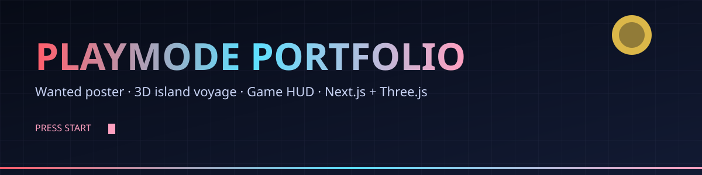
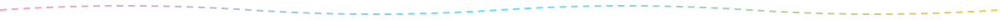
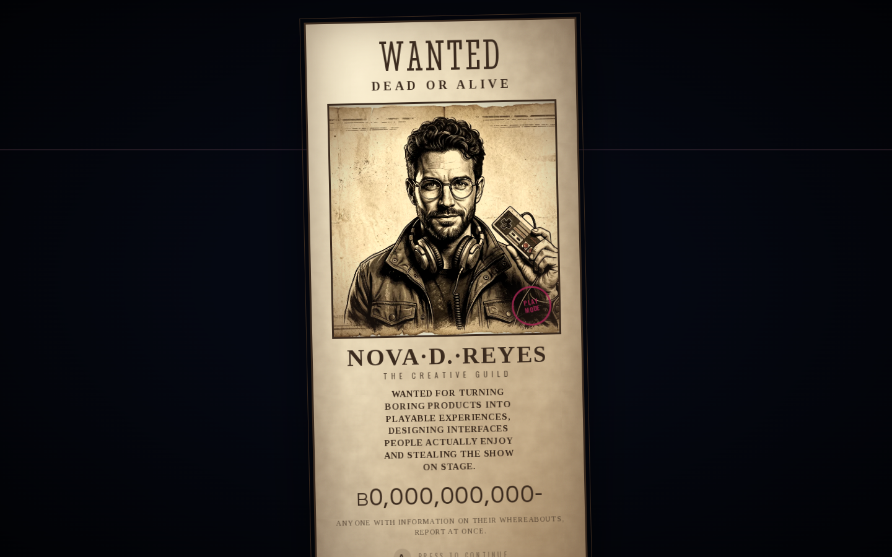
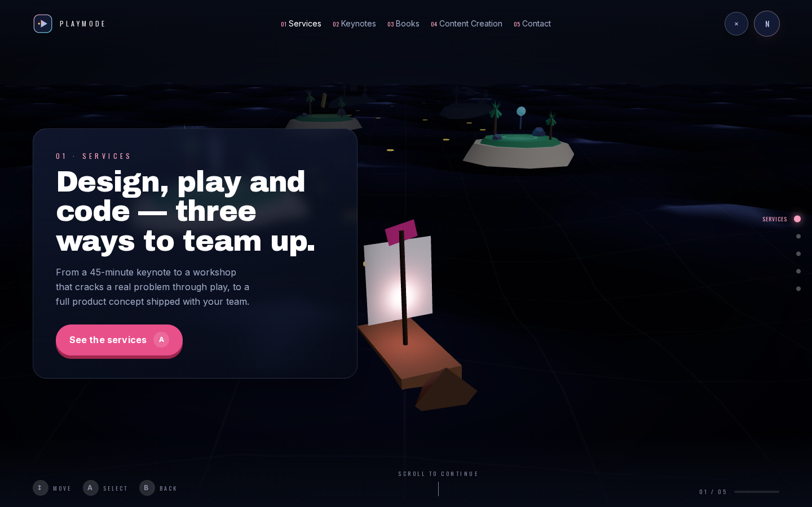
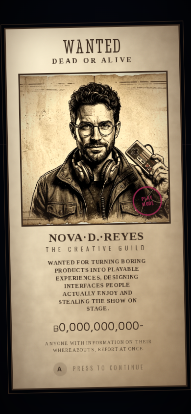

<div align="center">



<br />


### A gamified 3D portfolio template — wanted poster, island voyage, game HUD.

**Next.js 15 · React Three Fiber · GSAP · Lenis · Tailwind CSS v4 · TypeScript**

<br />

[](https://nextjs.org/)
[](https://threejs.org/)
[](https://gsap.com/)
[](https://lenis.darkroom.engineering/)
[](https://tailwindcss.com/)
[](https://www.typescriptlang.org/)
[](LICENSE)
[](.github/workflows/deploy.yml)

<br />

`PRESS START` · `SCROLL TO SAIL` · `A SELECT` · `B BACK` · `N MENU`

</div>



## 🎮 Overview

**Playmode Portfolio** is a story-driven portfolio template. Instead of a flat landing page, visitors land on a vintage **wanted poster**, press start, and sail through a low-poly 3D ocean. Each chapter — Services, Keynotes, Books, Content Creation, Contact — is an island with its own accent color, floating prop and collectible coins.

It ships with two experiences:

| Mode               | Route                  | Description                                                                     |
| ------------------ | ---------------------- | ------------------------------------------------------------------------------- |
| 🕹️ **Game mode**   | `/`                    | Preloader → wanted poster → start screen → 3D voyage → pause menu → end screen  |
| 📄 **Simple mode** | `/simple`              | Clean, accessible, scroll-reveal one-pager for recruiters and low-power devices |
| 🔒 **Legal**       | `/privacy`, `/imprint` | Static legal pages                                                              |
| 🚫 **404**         | `404.html`             | Animated “GAME OVER” page                                                       |

<div align="center">
  
  
  
</div>


- 🪧 **Wanted-poster intro** with parchment texture, sepia portrait, stamp animation and bounty typography
- 🌊 **Scroll-driven 3D voyage** — camera follows a Catmull-Rom spline past five themed islands
- 🧭 **Game HUD** — chapter dots, progress bar, key-cap hints, sound toggle, pause menu
- 🎯 **Custom cursor** with magnetic hover ring (auto-disabled on touch)
- ⌨️ **Keyboard + gamepad support** — `Enter/A` select, `Esc/B` back, `N/M` menu, arrows/`W/S` sail, `1–5` jump
- 🔊 **Optional chiptune SFX** generated with the Web Audio API (no audio files)
- 📱 **Fully responsive** — mobile layout, touch sailing, reduced-motion support
- 🧩 **Detail modals** for services, keynotes, book and content stats
- 📄 **Simple website version** with marquee, reveal animations and full content
- 🚀 **Static export** — deploy to GitHub Pages, Netlify, Vercel or any static host
- 🎨 **Centralized content** — edit one file to rebrand the whole site


| Layer         | Technology                               | Why                                                                   |
| ------------- | ---------------------------------------- | --------------------------------------------------------------------- |
| Framework     | **Next.js 15 App Router**                | Static export, image/font optimization, file-based routes             |
| 3D            | **Three.js + @react-three/fiber + drei** | Declarative scene graph, stars, instanced collectibles                |
| Animation     | **GSAP + ScrollTrigger**                 | Poster reveal, chapter reveals, scroll progress                       |
| Smooth scroll | **Lenis**                                | Buttery wheel/touch scrolling synced to ScrollTrigger                 |
| Styling       | **Tailwind CSS v4**                      | `@theme` tokens, keyframes, utility-first layout                      |
| State         | **Zustand**                              | Tiny global game state (phase, chapter, progress, sound)              |
| Language      | **TypeScript**                           | Typed content, components and scene props                             |
| Fonts         | **next/font/google**                     | Inter, Archivo Black, Tinos, Stint Ultra Condensed, Questrial, Oswald |


### Requirements

- **Node.js 18.18+** (Node 20 LTS recommended)
- npm, pnpm, yarn or bun

### Run locally

```bash
# 1. install dependencies
npm install

# 2. start the dev server
npm run dev

# 3. open the game
# http://localhost:3000
```

### Build the static site

```bash
npm run build      # exports to /out
npx serve out      # preview the production build locally
```

> The site is a **static export** (`output: 'export'`). No Node server is required in production.


```txt
playmode-portfolio/
├─ .github/workflows/deploy.yml   # GitHub Pages CI
├─ assets/readme/                 # animated SVG banners + previews
├─ public/
│  ├─ images/                     # wanted portrait, book cover (webp + png)
│  └─ .nojekyll
├─ src/
│  ├─ app/
│  │  ├─ layout.tsx               # fonts, metadata, theme color
│  │  ├─ page.tsx                 # game mode entry
│  │  ├─ globals.css              # Tailwind v4 theme + keyframes
│  │  ├─ simple/page.tsx          # simple one-pager
│  │  ├─ privacy/page.tsx
│  │  ├─ imprint/page.tsx
│  │  ├─ not-found.tsx            # GAME OVER 404
│  │  └─ icon.svg
│  ├─ components/
│  │  ├─ Experience.tsx           # phase orchestrator
│  │  ├─ Preloader.tsx
│  │  ├─ WantedPoster.tsx
│  │  ├─ StartScreen.tsx
│  │  ├─ HUD.tsx
│  │  ├─ Menu.tsx
│  │  ├─ Chapters.tsx             # scroll sections + detail modals
│  │  ├─ Cursor.tsx
│  │  ├─ Logo.tsx
│  │  └─ scene/
│  │     ├─ VoyageScene.tsx       # Canvas, camera rig, lights
│  │     ├─ Ocean.tsx             # custom wave shader
│  │     ├─ Island.tsx            # palms, rocks, floating props
│  │     ├─ Boat.tsx
│  │     └─ Collectibles.tsx      # instanced spinning coins
│  ├─ lib/
│  │  ├─ content.ts               # ✏️ ALL copy, chapters, services, socials
│  │  ├─ audio.ts                 # Web Audio SFX
│  │  ├─ useLenis.ts
│  │  ├─ useKeyboard.ts
│  │  └─ useGamepad.ts
│  └─ store/useGame.ts            # Zustand game state
├─ next.config.mjs                # static export + optional basePath
├─ tailwind via postcss.config.mjs
├─ tsconfig.json
├─ package.json
├─ LICENSE
└─ .gitignore
```


### 1. Rebrand in one file

Edit `src/lib/content.ts`:

```ts
export const site = {
  name: "Your Name",
  alias: "YOURBRAND",
  role: "Your role",
  email: "you@example.com",
  bounty: "$ 0,000,000,000-",
  // ...
};
```

Chapters, services, keynotes, socials and client marquee live in the same file.

### 2. Replace the images

| File                                 | Used for                   | Recommended size            |
| ------------------------------------ | -------------------------- | --------------------------- |
| `public/images/wanted-portrait.webp` | Wanted poster portrait     | 1024×1120, sepia works best |
| `public/images/book-cover.webp`      | Book chapter + simple page | 768×1376                    |

Keep the filenames, or update the paths in `WantedPoster.tsx`, `Chapters.tsx` and `simple/page.tsx`.

### 3. Change the color theme

All tokens are in `src/app/globals.css`:

```css
@theme {
  --color-navy-900: #070b16;
  --color-primary-200: #fea0c0;
  --color-cyan-glow: #5be0ff;
  --color-gold: #f2c94c;
}
```

Chapter accent colors are set per chapter in `content.ts`.

### 4. Add / remove islands

Add an entry to `chapters` in `content.ts`, then add a matching prop kind in `src/components/scene/VoyageScene.tsx` (`kinds` array) and `Island.tsx`. The spline, HUD, menu and keyboard shortcuts update automatically.


| Input                         | Action                                   |
| ----------------------------- | ---------------------------------------- |
| `Enter` / `A` / gamepad ✕     | Continue, start voyage, open chapter CTA |
| `Esc` / `B` / gamepad ○       | Close menu / modal                       |
| `N` / `M` / gamepad Start     | Pause menu                               |
| `↑ ↓` / `W S` / gamepad D-pad | Sail to previous / next chapter          |
| `1–5`                         | Jump to chapter                          |
| Mouse wheel / touch swipe     | Sail continuously                        |
| `♪` button                    | Toggle chiptune SFX                      |


This repo includes a ready workflow: `.github/workflows/deploy.yml`.

1. Push the project to a GitHub repository.
2. Go to **Settings → Pages**.
3. Under **Build and deployment**, set **Source** to **GitHub Actions**.
4. Push to `main` (or run the workflow manually).
5. Your site appears at:
   - `https://<username>.github.io/<repo>/` for project repos
   - `https://<username>.github.io/` for `<username>.github.io` repos

The workflow automatically sets `NEXT_PUBLIC_BASE_PATH` for project pages.

### Other hosts

```bash
npm run build
# upload /out to Netlify, Vercel, Cloudflare Pages, S3, etc.
```


- ♿ Respects `prefers-reduced-motion`
- 📱 Custom cursor disabled on touch devices
- 🔇 Sound is **off by default**
- 🖼️ Images use `next/image` with explicit dimensions
- 🧊 3D collectibles use instancing; DPR is capped on mobile
- 🧭 Keyboard and gamepad navigation for the full game flow
- 📄 Simple mode provides a non-3D, screen-reader-friendly alternative


Released under the **MIT License**. See [LICENSE](LICENSE).

You are free to use this template for personal and commercial portfolios. Attribution is appreciated but not required.

<div align="center">


**Made with play.**  
`THANKS FOR PLAYING · PRESS START TO CONTINUE`


</div>


<div align="center">

## Support

If you found this template helpful, please consider leaving a ⭐! It helps others discover the project and keeps me motivated to maintain it.

</div>
